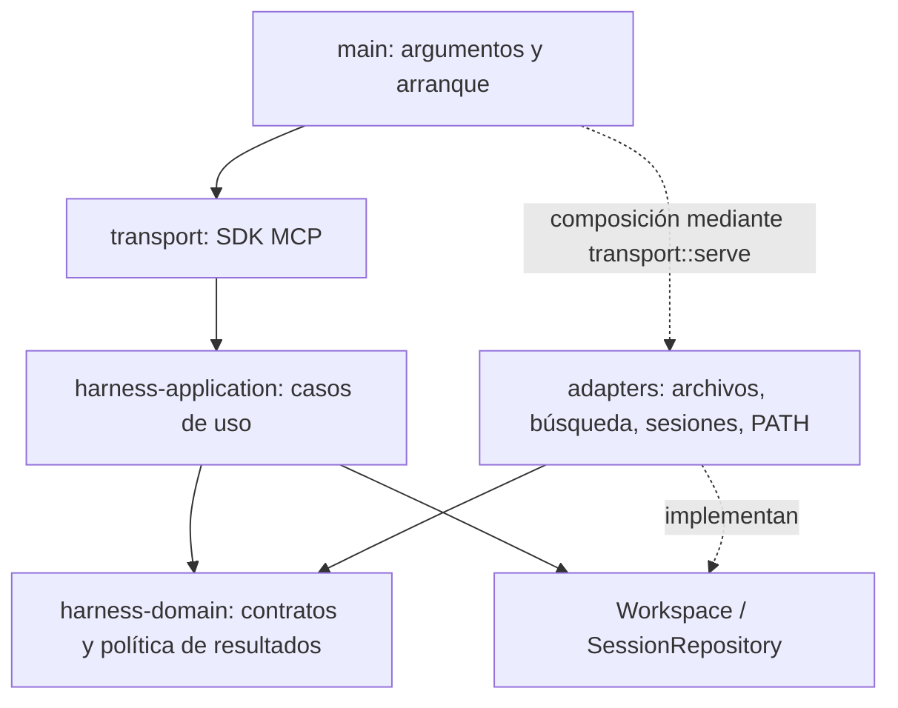

# Arquitectura del harness Rust

Monolito modular, un ejecutable y fronteras entre crates. El objetivo es añadir
herramientas y motores sin acoplar sus reglas al protocolo MCP o a una plataforma.



## Responsabilidades y límites

| Ubicación | Responsabilidad | Dependencias permitidas |
|---|---|---|
| `crates/domain` | Solicitudes tipadas, errores, hash, envelope, detalles, paginación UTF-16 y presupuestos del almacén | Bibliotecas de datos/criptografía; schema JSON opcional |
| `crates/application` | Punto de entrada único, admisión de sesiones, bootstrap, caché de reglas/capacidades, coordinación y respuestas | Domain y puertos propios; sin SDK MCP, Tokio ni adaptadores |
| `src/adapters` | I/O seguro, comprobaciones del sistema operativo, búsqueda nativa, persistencia y detección PATH | Puertos de aplicación y domain; sin llamadas al transporte MCP |
| `src/transport.rs` | Registro de herramientas, validación/deserialización por el SDK y conversión a `CallToolResult` | Aplicación y SDK MCP |
| `src/main.rs` | CLI y arranque | Composición del ejecutable |

Los tipos de solicitudes están en domain. `schemars` se activa solo mediante la
feature `schema`, necesaria para exponerlos al SDK. Domain y aplicación pueden
compilarse/probarse sin activar esa feature y sin construir un servidor MCP.
Los tipos del SDK no forman parte de la API de aplicación: `execute(Request)`
devuelve el envelope JSON independiente del transporte.

Las comprobaciones de enlaces, metadata, lectura acotada y publicación atómica
permanecen junto al I/O en los adaptadores. Validar los datos persistidos también
es responsabilidad del adaptador: no debe rehidratar verificaciones como vigentes.

## Reglas para añadir herramientas

1. Definir solicitudes/contratos en domain, sin tipos de SDK ni handles de procesos.
2. Coordinar admisión de sesión y respuesta desde `Application::execute`.
3. Añadir un puerto específico solo si el caso de uso requiere una capacidad nueva.
4. Implementar I/O en un adaptador; conservar límites, redacción de secretos y controles de rutas.
5. El handler MCP solo traduce la solicitud y llama a la aplicación.
6. Verificar el caso de uso con adaptadores en memoria y el contrato externo por MCP.

Evitar un puerto genérico que ejecute texto de shell. El puerto de procesos
recibe una especificación validada de ejecutable/argumentos y un presupuesto,
sin convertir entradas de herramientas en comandos de shell.

### Procesos y verificación (0.4.0)

Python añade solo un plan de proceso y un Program cerrado al mismo puerto.
Build exige archivo .py y usa py_compile; test exige directorio y usa unittest
discover con patrón fijo. Los argumentos -I/-S impiden hooks de arranque/config
Python heredada; no se ejecutan scripts ad-hoc ni intérpretes aportados por el
request. Discovery sí importa el directorio autorizado: no es un sandbox.
Se conserva la normalización de fallos y la observación local no certificada.
verificationMode y testCountVerified=false evitan presentar compilación o cero
tests como una garantía de corrección. Las pruebas reales son opt-in por runtime.

Go usa el mismo puerto ProcessRunner y el mismo caso de uso que Rust: no hay
segundo ejecutor ni bypass del gate de sesión. go_plan solo admite un módulo
local y construye argumentos cerrados (-C, build/test, paquete .). Program::Go
se resuelve desde PATH absoluto; la política de entorno se aplica al Command
hijo, nunca al proceso global. Deshabilita hooks GOFLAGS/GOCACHEPROG, selección
remota de toolchain, descargas del comando Go, cgo y go.work. Estas restricciones
no son un sandbox del código del proyecto ni controlan la red de sus tests.
Doctor usa go version opt-in y solo publica componentes numéricos. La prueba
real es opt-in; el contrato, scopes y entorno se prueban sin requerir Go instalado.

`domain::process::ProcessSpec` es interno, no deserializable desde MCP, con campos
privados y constructor validado. Identifica Cargo/Rustc/Git mediante enum; no acepta
un ejecutable arbitrario. Limita cada ejecución a 30 s, 2 MiB de salida combinada,
128 argumentos y 16 KiB de argumentos UTF-8; rechaza NUL. Esto no sustituye la
validación de acciones, rutas y argumentos por la futura herramienta de verificación.
Cargo y sus tests pueden ejecutar código del proyecto: no son un sandbox.

`ProcessRunner` es el puerto independiente de plataforma. `ProcessOutcome` distingue
salida normal, cancelación, timeout y exceso de salida, y no presupone que los
descendientes hayan terminado. `process_output::Output` conserva bytes de ambos
flujos con un presupuesto común; requiere sincronización si se usa desde dos lectores.
La decodificación UTF-8 se realiza después de reunir los bloques de cada flujo.

`NativeProcessRunner` implementa el puerto. El adaptador de verificación valida la
ruta del manifiesto con Project y crea argumentos fijos Cargo build/test; el handler
MCP pasa por la admisión común y conserva permisos/leases durante la limpieza.
No se publica una herramienta de comandos arbitrarios. Los archivos `process.rs`,
`process_tree.rs` y `verify.rs` separan resolución/colección, OS y planificación.

Windows usa directamente la API de Job Objects: líder suspendido, asignación,
reanudación, kill-on-close y comprobación de ActiveProcesses antes de confirmar
cierre del árbol. No se usa una completion port para inferir que el job terminó.
No hay contención durante la pequeña ventana entre spawn suspendido y asignación
si el harness es terminado abruptamente. Unix emplea grupos de procesos, no impide
setsid y no confirma el árbol completo. La validación de esta etapa es Windows.
Referencias de la API: [asignación al job](https://learn.microsoft.com/en-us/windows/win32/api/jobapi2/nf-jobapi2-assignprocesstojobobject)
y [contador ActiveProcesses](https://learn.microsoft.com/en-us/windows/win32/api/winnt/ns-winnt-jobobject_basic_accounting_information).
La salida usa dos lectores, una cola acotada de ocho bloques de 8 KiB y un presupuesto
común de 2 MiB. Tras terminar el job hay hasta 5 s adicionales para drenar/reap;
si no finaliza se informa PROCESS_CLEANUP. Los errores conservan limpieza RAII.
No se implementan todavía verificadores personalizados, otros lenguajes, diagnósticos
estructurados ni registro de vigencia. Cargo build/test puede ejecutar código y
descargar dependencias: esto no es aislamiento de proyectos hostiles.

### Batch de lecturas

Domain define un catálogo cerrado de hijos y decodifica los argumentos antes de
arrancar. Application coordina pares de threads con scope; cada hijo vuelve a
la entrada execute_with_context con el mismo plazo/cancelación y conserva la
admisión/lease/medición normal. No se expone ejecución genérica ni batch recursivo.
Hay dos permisos de coordinación separados de los cuatro permisos de trabajo,
evitando que los padres agoten todos los cupos necesarios para sus propios hijos.
Los errores de hijos se conservan por índice y la salida grande usa detalle común.

### XML y permisos externos

El mismo adaptador admite JSON usando serde_json existente, sin dependencias en
dominio/aplicación. Selecciona una propiedad top-level exacta y produce un árbol
sanitizado: nombres field_N y escalares "***". El árbol completo se valida contra
presupuestos antes de una redacción de profundidad acotada; solo el árbol redactado
se serializa y recorta. Errores del parser se sustituyen por CONFIG_JSON estático.
No hay resolución de referencias, interpolación ni exposición de tipos escalares.

ConfigArgs y ExternalScopeArgs son contratos distintos: leer una sección no
modifica settings; grant/revoke sí mutan el registro y esperan resultado definitivo
ante cancelación. La aplicación valida/pinea la sesión, usando su gate para estas
mutaciones. Workspace implementa los adaptadores; el dominio no depende del parser
XML ni de APIs Windows.

roxmltree vive solo en el adaptador, con DTD/resolver desactivados y presupuesto
de archivo/nodos/profundidad. El renderer itera sin recursión y solo construye
salida redactada: texto original y errores del parser nunca llegan al result store.
Los límites y la política de todos los valores redactados son más estrictos que Node.

NativeWorkspace mantiene un registro de scopes por sesión, acotado y volátil.
La aprobación FS y la resolución con pins se hacen fuera del mutex del registro;
solo IDs/paths/identidades/TTL permanecen guardados, no handles ociosos. Un Scoped
conserva handles de directorio/archivo mientras termina la lectura. Project aplica
el límite de archivo único, rutas sensibles y pinning de padres/hardlinks en las
lecturas externas. Solo los adaptadores redactados/metadata pueden consumir bytes
de configuración externa; no hay puerto de ejecución ni de escritura externo.

### Conteo file_size

El modo syntax comparte el recorrido y los presupuestos, y llama al colector
rust_symbols existente en lugar de añadir un segundo parser. Su selector cerrado
kind[:nombre] filtra declaraciones AST, no texto ni patrones generales. Solo emite
metadata de navegación y firmas; los errores originales del parser se descartan.
Los fallos por archivo incrementan skipped/parseErrors y hacen complete=false.
Los guards del permiso externo permanecen vigentes durante el recorrido, igual
que en búsquedas existentes. No se evalúan macros/cfg ni se infieren relaciones.

SearchArgs permite query ausente solo para el modo file_size, validado por el
adaptador. Comparte walker/ignores y lecturas sin enlaces. Project expone una
lectura interna con límite reducido por reserva, sin ampliar el límite público
de 2 MiB; la metadata previa reserva presupuesto incluso ante errores. El
adaptador devuelve únicamente ruta/líneas/bytes y recorta resultados con la
política de detalle común. No necesita CodeGraph ni un proceso externo.

### Buffer de logs

prepare genera un UUID de operación antes de admisión; Measurement lo conserva
en terminal/rechazo/abandono y Operation lo adjunta al envelope. El transporte
retiene ese ID antes de ceder el worker y lo reutiliza en salidas tempranas o
fallos de join. Los hijos de batch se preparan antes de spawn para conservar su
ID incluso si falla el arranque/join; cada hijo mantiene su medición normal.
El filtro valida el UUID canónico, sin retener valores arbitrarios. No es un
identificador de sesión ni el id JSON-RPC, y no certifica entrega al cliente.

Application consulta el log propio sin un puerto de filesystem. El guard de
medición emite eventos terminales/rechazos/abandonos con esquema fijo; los códigos
se mapean a una lista permitida. El buffer contiene como máximo 512 entradas,
independiente de persistencia y del repositorio de sesiones. Métricas y eventos
usan locks separados y sus snapshots no pretenden ser una transacción conjunta.
La instrumentación completa del transporte MCP sigue pendiente.

Workspace ofrece puertos de carga/guardado de archivos de log. La aplicación
los invoca solo si el adaptador declara persistencia habilitada; el constructor
restaura un snapshot validado sin restaurar métricas. Operation termina la medición
y luego intenta guardar fuera de locks de sesiones/logs, conservando el permiso
hasta terminar. No se hace I/O en Drop ni al rechazar admisión en el hilo async.
Los rechazos/abandonos pendientes entran en el siguiente snapshot completado.

Domain valida un formato cerrado de metadatos. DiskLogs Windows mantiene los
ancestros fijados y un lock de escritor OS; serializa snapshots, rechaza regresión
de secuencia y usa nombres fijos current/previous/next. El staging se sincroniza,
conserva DACL y se publica sin sobrescribir un destino inesperado. Hay recuperación
de staging válido; corrupción o archivos desconocidos no se borran automáticamente.
No es una transacción durable ante energía ni un sandbox contra otro proceso
hostil de la misma cuenta. El modo es opt-in; --persist-logs no cambia el MCP activo.

### Métricas de aplicación

Application comparte un almacén acotado por catálogo de herramientas entre sus
clones. prepare registra rechazo o crea un guard de medición junto al permiso.
Operation finaliza el guard con el estado del envelope real del worker; Drop
registra abandono si no hubo resultado. La medición se libera antes del permiso
para no inflar actividad al admitir el siguiente worker. No almacena argumentos,
sesiones ni mensajes; el mutex solo protege contadores y snapshots en memoria.

La frontera de aplicación adjunta snapshots a doctor/checkpoint, incluido el
detail, después del caso de uso y fuera del mutex del repositorio de sesiones.
Los snapshots no entran en la persistencia. Se mide tiempo monotónico desde la
reserva, no CPU ni entrega RPC, y no se cuenta la consulta actual como completada
en su propio snapshot. No es todavía paridad de SessionStats/ReadStats de Node.

### Diagnóstico nativo

Doctor usa un puerto tipado Workspace y la misma admisión/lease que las lecturas.
El adaptador inspecciona metadatos locales; no escribe ni expone configuración.
Comparte resolución de ejecutables con NativeProcessRunner. Las sondas opt-in
crean ProcessSpec fijo --version (2 s, 4 KiB), no comandos definidos por el agente.
Solo serializa versiones numéricas, nunca salida bruta ni stderr. Estado skipped
es cobertura no comprobada, no una conexión sana. CodeGraph/SQL no se diagnostican
todavía. El modo por defecto no inicia procesos ni gestores de toolchain.

### Git nativo de solo lectura

`Workspace` publica puertos tipados git_status/git_diff. La aplicación conserva
admisión y lease; el transporte no ejecuta procesos. `adapters::git` valida
argumentos, raíz efectiva de Git y rutas, anula filtros y configura argumentos
fijos. Comparte `NativeProcessRunner`, contención de procesos y presupuestos.
El runner elimina variables GIT_* heredadas solo para Program::Git, sin cambiar
el entorno de Cargo. No hay shell ni herramienta de comandos genéricos.

Status usa registros NUL de porcelain v2 y no hace fetch para actualizar upstream.
Diff no usa textconv ni diff externo. Se rechazan linked worktrees por ahora y
salidas parciales/errores no se presentan como datos completos. stderr nunca se
publica porque puede contener configuración sensible. Las pruebas usan repositorios
temporales e inyección de filtros para verificar que no se ejecuten programas.

### Edición (0.5.0)

`domain::editing` planifica el cambio sin I/O: hash, match único, EOL y límites.
La aplicación obtiene lease/admisión y llama al puerto Workspace::replace.
El adaptador se divide en `edit.rs` (validación/orquestación), `edit_commit.rs`
(rutas/pinning/publicación/recuperación) y `edit_security.rs` (DACL del temporal).
Los clones comparten mutex de escritura; al saturar se rechaza, sin cola de edits.
Windows usa ancestros abiertos sin FILE_SHARE_DELETE y ReplaceFileW con backup.
Los fallos inciertos no se convierten en «archivo intacto» y conservan recuperación.
La DACL se copia y protege antes de escribir contenido en staging.
Referencias: [ReplaceFileW](https://learn.microsoft.com/en-us/windows/win32/api/winbase/nf-winbase-replacefilew)
y [syn::parse_file](https://docs.rs/syn/latest/syn/fn.parse_file.html).

Rust/JSON requieren candidato íntegramente válido; Markdown/TXT no tienen validador
de contenido y se informa explícitamente. Los demás formatos fallan cerrados.
La edición es Windows-only; falta publicación Unix con operaciones ancladas en
handles. No hay CAS frente a procesos externos durante la ventana final hash/replace.
No se promete aislamiento de procesos hostiles ni durabilidad ante pérdida de energía.

Request::is_mutating hace que cancelación/timeout espere el resultado del trabajador
en vez de responder antes del commit. La aplicación tampoco sobrescribe ese
resultado con un chequeo de cancelación posterior. El último checkpoint antes de
publicar puede abortar sin cambios; una publicación iniciada debe informar su resultado.
Al desconectarse el cliente no puede confirmarse entrega: debe releer antes de repetir.
El timeout es nominal/cooperativo, no puede interrumpir una llamada FS bloqueada.

### Navegación Rust (0.6.0)

Outline/ReadSymbol pasan por la misma admisión y leases que las lecturas. Los tipos
de solicitud son domain y el puerto Workspace delega en `symbols.rs`: selección,
ambigüedad, vista firma/cuerpo y detalle. `rust_symbols.rs` visita declaraciones y
construye datos propios; `rust_syntax.rs` comparte presupuestos y parseo con edición.
No se usan búsquedas de texto para inferir relaciones, ni Node, ni CodeGraph.

Spans de proc-macro2 se convierten a rangos UTF-8 exactos y luego a offsets UTF-16
para los IDs. No se devuelve código generado desde AST. BOM/shebang se ajustan
sin cambiar posiciones de los tokens. El AST muere antes de invalidar la arena de
spans del thread; no hay referencias/tokens/spans persistentes ni caché compartida.
Referencia: [Span::byte_range](https://docs.rs/proc-macro2/latest/proc_macro2/struct.Span.html#method.byte_range).

El dominio genera anclas limitadas para Read y ReadSymbol. Las firmas no se ofrecen
como oldText. El ID cambia con todo cambio del archivo; duplicados requieren
container o ID vigente. Los resultados grandes siguen la política de detalle común.
Cobertura deliberadamente parcial: declaraciones/módulos inline/impl/trait, sin
locales, expansión de macros, cfg, imports, carga de módulos ni relaciones semánticas.

### Tareas, checkpoint y observaciones (0.7.0)

TaskBoard vive en domain: transiciones declaradas, notas, secuencia y timeline
acotado; recibe timestamps como datos, sin reloj ni filesystem. Native genera
timestamps UTC y mantiene las observaciones de esta instancia separadas del
histórico restaurado. Se persiste v1 compatible con Node; nunca se restauran
checks como vigentes. La vigencia total aún no está implementada.
refreshFreshness obtiene una huella acotada mediante Workspace fuera del mutex
global, reteniendo el gate por sesión. Domain deriva la comparación local en la
respuesta y su detail, sin guardarla como vigencia permanente ni revalidar
checks históricos; current permanece null.

Los casos de uso obtienen un gate estable por sesión a través de SessionRepository,
mantienen el lease y rechazan otro escritor/verificador con SESSION_BUSY. El
repositorio modifica memoria y entrega SessionMutation con snapshot propio.
Workspace publica ese snapshot fuera del mutex global, reteniendo el gate para
evitar inversión de orden entre clones. Las lecturas de estado no requieren ese
gate: una prueba de persistencia bloqueada comprueba que el repo sigue legible.
Bootstrap/restauración pueden seguir haciendo I/O bajo el mutex como antes;
la separación de esta etapa se aplica a los nuevos guardados de workflow.

Los resultados de Replace/Verify alimentan hechos observados antes de soltar el
gate. Fallos de registro/persistencia se adjuntan como advertencias sin convertir
una edición realizada en una supuesta ausencia de cambios. Una actualización de
plan/checkpoint ya iniciada informa su resultado aunque se cancele el handler.
Timeline es volátil y se reinicia también con una restauración tras evicción.
No hay coordinación de escritores entre procesos ni seguimiento actual de versiones.

## Crecimiento y concurrencia

Ya están acotados el almacén de resultados, la caché de sesiones, los archivos y
las búsquedas. Clones de la aplicación comparten sesiones, resultados y admisión.
`Application::prepare` reserva hasta cuatro operaciones y hasta dos búsquedas,
antes de crear un trabajador. Rechaza con `QUEUE_FULL`, sin una cola propia.
El permiso se libera mediante RAII incluso si la operación nunca se ejecutó.

Cada operación adquiere un lease antes del I/O y lo conserva hasta producir el
envelope. Las sesiones con leases no pueden ser expulsadas de la caché. Bootstrap
solo mantiene el mutex al abrir/adquirir la sesión y al actualizar hashes;
las lecturas de reglas, detección y escaneos no mantienen ese mutex.

`OperationContext` en domain lleva cancelación y plazo usando std, sin Tokio.
Los adaptadores comprueban el contexto entre bloques/pasos; el transporte enlaza
la señal MCP, mueve ejecución a `spawn_blocking` y responde al cancelar o vencer
30 s. Si el trabajador continúa, sigue reteniendo permiso y lease hasta terminar.
Las llamadas al sistema de archivos ya bloqueadas no se pueden interrumpir con
este mecanismo. La entrada stdio se limita a 128 KiB por mensaje antes del SDK.

Faltan edición Unix, parsers de otros lenguajes y comprobación de vigencia del código.
Se prueban saturación, recuperación, cancelación y liberación de leases;
esto no constituye un benchmark de rendimiento ni una garantía de latencia del SO.

No se necesitan servicios separados para esas capacidades. Motores auxiliares como
XLSX/SQL pueden permanecer como procesos bajo un adaptador y un contrato explícito.

## Verificación de fronteras

`tests/architecture.rs` revisa los metadatos reales de Cargo y exige una lista
aprobada de dependencias para domain y aplicación. Añadir una nueva dependencia
normal/de build requiere una decisión explícita y actualizar esa prueba.
Las dependencias de desarrollo se permiten para pruebas aisladas.

`crates/application/tests/use_cases.rs` comprueba admisión antes del I/O y cachés
compartidas sin filesystem, procesos, Tokio ni MCP. Se conservan pruebas de
adaptadores, protocolo real y comparación con las clases Node existentes.

Comandos desde la raíz del repositorio:

```powershell
cargo test --locked --workspace --manifest-path .agents/harness/native/core/Cargo.toml
cargo clippy --locked --workspace --all-targets --manifest-path .agents/harness/native/core/Cargo.toml -- -D warnings
cargo test --locked -p harness-application --no-default-features --manifest-path .agents/harness/native/core/Cargo.toml
node --test .agents/harness/native/core/tests/node-compat.test.cjs
```
