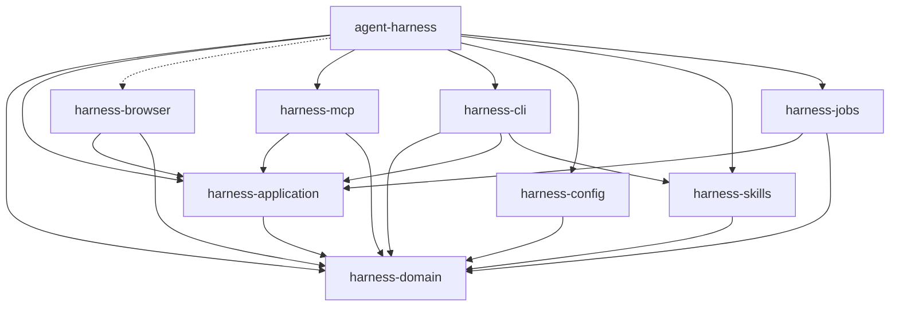

# Mapa del proyecto Harness

[Skill project-map](docs/project-map/skill/SKILL.md): consulta primero la sección relevante de este mapa. Carga la skill para ampliar o actualizar la información; verifica después las fuentes concretas del cambio.

Observado: **2026-10-28**. Raíz: `E:/harness_mix`. HEAD: `f738853aaf1980e7b0ea1b944fdfaa4512918e04`.

Incluye cambios locales de browser sin commit; el mapa describe el código fuente, no el servidor instalado. Este es un mapa general para navegar, no una auditoría exhaustiva.

## Cómo leerlo

- **Comprobado:** paquetes y dependencias internas declaradas en Cargo.
- **Documentado:** responsabilidades descritas por las fachadas y README enlazados.
- **Inferido:** las rutas recomendadas para abordar cambios; necesitan revisión en cada tarea.
- **Pendiente:** rutas de ejecución completas, macros, invocaciones dinámicas y configuración externa.

El índice tiene frescura global `not_certified`; los archivos observados en la consulta de `main` coincidían con el índice. No se reindexó. El diagrama se deriva de manifiestos, no de una supuesta cobertura completa del grafo.

## Dependencias internas

Una flecha **A -> B** significa que A declara dependencia directa de B. La flecha discontinua indica la dependencia opcional `browser-cdp`, habilitada por defecto. Se muestran los ocho miembros explícitos del workspace y el paquete raíz. No se incluyen dependencias externas ni vendor.

## Módulos y responsabilidades

| Módulo | Responsabilidad documentada | Manifiesto |
|---|---|---|
| [agent-harness](src/lib.rs) | Ejecutables, composición y adaptadores nativos de archivos, índices, bases de datos y verificación. | [Cargo](Cargo.toml) |
| [harness-domain](crates/domain/src/lib.rs) | Contratos independientes del transporte, hashes y políticas de resultados. | [Cargo](crates/domain/Cargo.toml) |
| [harness-application](crates/application/src/lib.rs) | Orquestación de casos de uso, sesiones, admisión y puertos. | [Cargo](crates/application/Cargo.toml) |
| [harness-browser](crates/browser/src/lib.rs) | Adaptador Chromium/CDP y casos de uso de inspección e interacción. | [Cargo](crates/browser/Cargo.toml) |
| [harness-mcp](crates/mcp/src/lib.rs) | Transporte MCP, catálogo, presentación, cancelación y límites de operaciones. | [Cargo](crates/mcp/Cargo.toml) |
| [harness-cli](crates/cli/src/lib.rs) | Comandos, argumentos, despacho y flujos de terminal interactiva. | [Cargo](crates/cli/Cargo.toml) |
| [harness-config](crates/config/src/lib.rs) | Configuración del runtime a partir de valores y entorno. | [Cargo](crates/config/Cargo.toml) |
| [harness-skills](crates/skills/src/lib.rs) | Catálogo embebido y sincronización de skills con control de propiedad. | [Cargo](crates/skills/Cargo.toml) |
| [harness-jobs](crates/jobs/src/lib.rs) | Trabajos de verificación persistentes: admisión, ejecución y observación. | [Cargo](crates/jobs/Cargo.toml) |

Fuentes de responsabilidades:

- [crates/domain/src/lib.rs](crates/domain/src/lib.rs): Contratos y políticas sin transporte.
- [crates/application/src/lib.rs](crates/application/src/lib.rs): Orquestación y puertos; sin adaptadores OS ni MCP.
- [crates/cli/README.md](crates/cli/README.md): Responsabilidades y contratos del CLI.
- [crates/mcp/README.md](crates/mcp/README.md): Transporte, presentación y límites MCP.
- [crates/config/README.md](crates/config/README.md): Configuración de runtime; no configuración de bases de datos.
- [crates/skills/README.md](crates/skills/README.md): Catálogo embebido y sincronización.
- [crates/jobs/README.md](crates/jobs/README.md): Persistencia y ciclo de trabajos.
- [src/adapters/composition.rs](src/adapters/composition.rs): Composición e inyección de adaptadores nativos.
- [crates/browser/src/lib.rs](crates/browser/src/lib.rs): Fachada BrowserService y BrowserBackend.

## Puntos de entrada

- [src/main.rs](src/main.rs): entrada `agent-harness`; llama a `cli::run`.
- [src/cli.rs](src/cli.rs): `run` delega a `harness_cli::commands::run` con el host nativo.
- [archive/antigravity](archive/antigravity/): conserva el lanzador y el cliente `harnessmix` fuera del workspace y de la compilación de MCP.
- [src/transport/runtime.rs](src/transport/runtime.rs): exporta servidor de proyecto único y servidor de workspace.
- [src/adapters/composition.rs](src/adapters/composition.rs): construye adaptadores y selecciona el backend de navegador según la feature.

## Dónde empezar según el cambio

Recomendaciones de navegación, no pruebas ejecutadas al crear este mapa.

| Cambio | Empezar en | Continuar / verificar |
|---|---|---|
| Cambiar parámetros o contratos de herramientas | `crates/domain/src` | crates/application y crates/mcp. `cargo test -p harness-domain --features schema` |
| Cambiar presentación o catálogo MCP | `crates/mcp/src` | crates/domain para contratos; host para composición. `cargo test -p harness-mcp` |
| Cambiar búsqueda, edición, parsing o índices | `src/adapters` | crates/application/src/ports y casos de uso. `Elegir tests de la capacidad en tests/; no reindexar sin autorización.` |
| Cambiar interacción con navegador | `crates/browser/src` | crates/domain/src/browser.rs y crates/mcp/src/server.rs. `cargo test -p harness-browser; pruebas Chromium ignoradas requieren entorno real.` |
| Cambiar trabajos de verificación | `crates/jobs/src` | Puertos de application y src/adapters/verification. `cargo test -p harness-jobs` |
| Cambiar comandos o terminal | `crates/cli/src` | src/cli.rs para el host. `cargo test -p harness-cli` |
| Cambiar distribución de skills | `crates/skills/src/catalog.rs` | .agents/skills y reglas de sincronización. `cargo test -p harness-skills` |

## Herramientas empleadas

- **Harness MCP:** Recuperar manifiestos, símbolos, relaciones y hashes.
- **Mermaid:** Diagrama editable en Markdown, sin servicio externo.
- **curl / documentación web:** Opcional, solo si una duda requiere fuentes externas; no usado aquí.

No hace falta curl para descubrir la estructura local. Si una tarea requiere documentación externa, usar una herramienta web o curl con fuentes oficiales y registrar la URL, versión y fecha. Leer documentación no demuestra que una relación exista en este repositorio.

## Fuentes, actualización y límites

Los datos y hashes están en [docs/project-map/map.json](docs/project-map/map.json). Se conserva el texto devuelto por Harness para los ocho módulos; el manifiesto raíz se referencia por ruta y hash. En `crates/cli/Cargo.toml`, el hash de archivo informado difiere del texto retornado: ambos hashes están registrados y no se certifica equivalencia de bytes.

- No se trazaron todas las rutas de ejecución, macros ni invocaciones dinámicas.
- No se verificaron despliegues ni configuración externa de clientes.
- Las dependencias externas, vendor y experiments quedan fuera del diagrama interno.
- No se ejecutan builds ni tests para generar este documento; los comandos son recomendaciones.

Para actualizar: comparar hashes de las fuentes, releer las cambiadas y revisar las afirmaciones afectadas. Mantener Markdown, JSON y el diagrama consistentes. El mapa se mantiene con Harness y las herramientas nativas del proyecto Rust. Conservar anotaciones humanas en una sección separada.

La skill está empaquetada en [docs/project-map/skill/SKILL.md](docs/project-map/skill/SKILL.md); todavía no está instalada en una ruta de descubrimiento automático porque Harness protege `.agents/skills`.

Markdown y JSON son las fuentes editables del mapa. La exportación a otros formatos queda fuera de este flujo.
