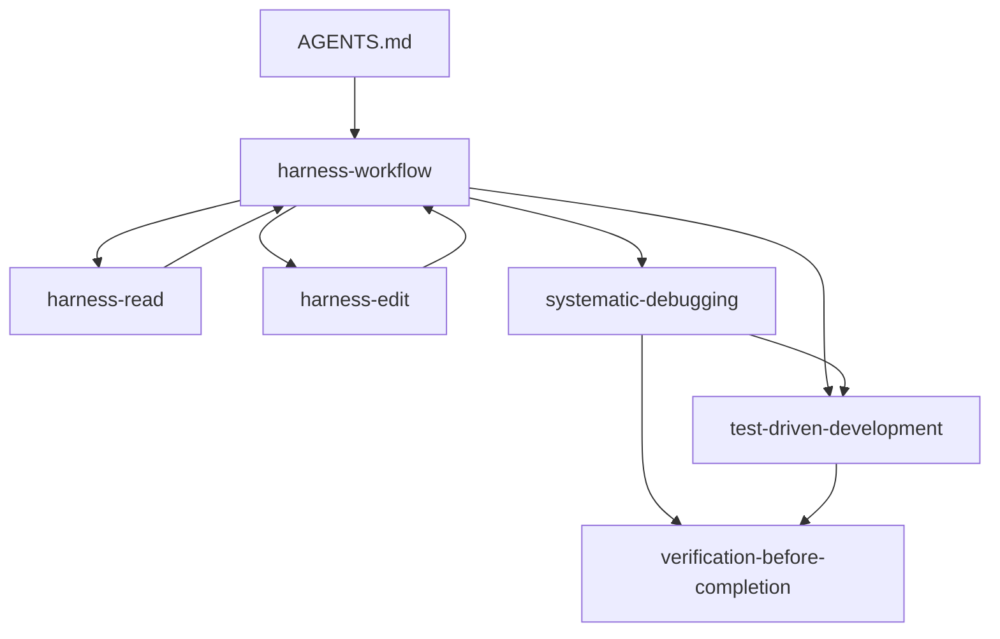
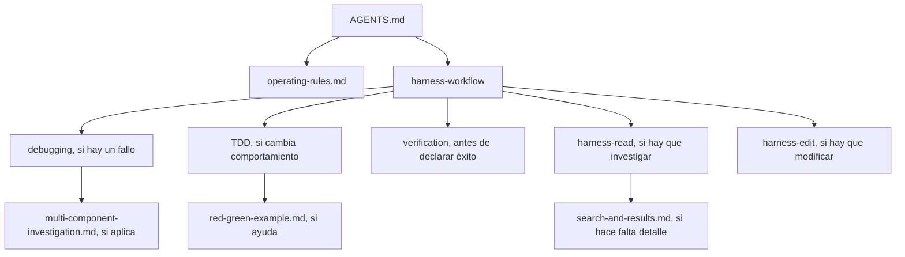

# Skills: carga y rutas

## Qué cambió

La fuente canónica sigue siendo `.agents/skills/**`; `crates/skills/src/catalog.rs`
la incluye con `include_str!`. Añadí referencias cortas al catálogo y actualicé
`workflow_bundle.rs`, sin ejecutar sincronización ni instalación en el workspace.

Los 15 entrypoints `SKILL.md` pasaron de **74,952** a **39,406 caracteres**
(−35,546; **−47.4 %**). Las reducciones principales fueron:

| Skill | Antes | Después |
| --- | ---: | ---: |
| `harness-read` | 8,301 | 2,684 |
| `systematic-debugging` | 9,789 | 1,938 |
| `test-driven-development` | 9,886 | 1,833 |
| `harness-workflow` | 4,596 | 1,875 |
| `harness-setup` | 5,851 | 3,253 |
| `harness-edit` | 3,758 | 1,710 |
| `verification-before-completion` | 3,718 | 1,186 |
| `improve-codebase-architecture` | 6,069 | 2,259 |

Los detalles condicionales siguen disponibles en referencias: reglas operativas
comunes, opciones de búsqueda y respuesta, investigación multi-componente y un
ejemplo RED/GREEN. Los guías de debugging, TDD y verificación conservan los
métodos esenciales sin duplicar el mismo procedimiento en cada skill.

## Grafo

Antes, `harness-read` y `harness-edit` apuntaban al router, que a su vez los
volvía a seleccionar; los mismos requisitos de sesión, permisos, indexación,
fallos y evidencia aparecían en varios entrypoints.

Ahora las reglas compartidas viven en una referencia hoja que se carga una vez
por tarea. `AGENTS.md` escoge la guía del trabajo; el router selecciona solo las
etapas pertinentes, y las guías no enlazan de vuelta al router.

El validador encuentra cero ciclos. También confirma los `name`/`description`,
links locales, rutas del router en `AGENTS.md` y que cada referencia enlazada
esté incluida en el catálogo.

## Hechos verificados y límites

- `workspace init` recorre los proyectos que ya están en el manifiesto;
  `workspace add` prepara el proyecto agregado. Un manifiesto vacío no recibe
  skills como si su directorio fuera un proyecto. La implementación está en
  [workspace.rs, línea 248](../crates/cli/src/commands/workspace.rs) y respeta
  `auto_sync: false` mediante
  [project_support.rs, línea 15](../crates/skills/src/project_support.rs).
- `agent-harness init` instala skills y configuración local de proyecto/cliente;
  informa el comando `index` como siguiente paso y no crea el índice. El flujo
  está en [commands/mod.rs, línea 207](../crates/cli/src/commands/mod.rs) y
  [installation.rs, línea 304](../crates/skills/src/installation.rs).
- `structuredContent` es el sobre canónico en la presentación predeterminada;
  `content` muestra un resumen. La configuración usa el renderer structured
  por defecto en [server.rs, línea 74](../crates/mcp/src/server.rs) y puede seleccionar
  `legacy` o `context` en [runtime.rs, línea 58](../crates/config/src/runtime.rs).
  `dataTrace` queda como campo canónico; el renderer structured quita un
  `crossLayerTrace` idéntico en [presentation.rs, línea 38](../crates/mcp/src/presentation.rs).
- El review de arquitectura ahora enlaza archivos locales si existen y no
  presupone `Skill tool`, navegador, shell o red. El informe HTML de ejemplo
  funciona sin CDN ni scripts remotos.

## Validación

- `node scripts/validate-skills.cjs`: 15 frontmatters, 47 archivos del catálogo,
  links y rutas válidas, 0 ciclos.
- `rustfmt --check --edition 2024` en los tres archivos Rust cambiados: pasó.
- `cargo test --locked -p harness-skills`: **29 passed, 0 failed**, incluyendo
  `workflow_bundle`, que instala las referencias nuevas en un directorio
  temporal y comprueba su manifiesto.

No corrí `workspace init`, `skills sync` ni indexación en el workspace del
usuario. La cuenta de caracteres mide entrypoints `SKILL.md`, no tokens ni una
garantía de caché de un proveedor de modelos. Cada cliente puede descubrir o
recargar los archivos de skills de forma distinta.
